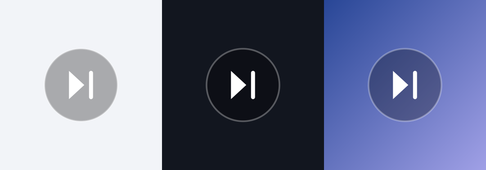

# 跳跳 · TiaoTiao

一个常驻在屏幕边缘的小球，点一下等于按了一次「下一首」。
用来跳过 App 的开屏广告、视频贴片广告，或者在任意音乐 App 里切歌。




## 特性

- **全局悬浮**：浮在所有应用之上，看视频、刷信息流、读小说时都能随手点。
- **一个动作**：点一下下发一次媒体「下一首」按键，语义等同蓝牙耳机上按一下切歌键。
- **零权限切歌**：只用 `AudioManager.dispatchMediaKeyEvent()` 这个公开 API，不申请蓝牙、不申请媒体库、不联网。
- **可拖动、自动贴边、位置记忆**：松手 180ms 缓动吸附到最近一侧，下次打开还在原处。
- **纯自绘**：透明圆形 + 纯 Logo，56dp，没有文字，不挡内容。
- **无第三方依赖**：不使用 AndroidX / Material，APK 只有 34 KB。
- **前台服务保活**：常驻通知，通知栏里可以直接隐藏悬浮球。

> 原理一句话：它不「控制」任何 App，只是替你按了一次媒体键，所以作用对象永远是
> **系统当前正在播放音频的那个 App**——与音频输出到哪里（扬声器 / 蓝牙 / 有线）无关。

## 兼容性

| 项目 | 说明 |
| --- | --- |
| 最低版本 | Android 8.0（API 26） |
| 编译 / 目标版本 | API 36 |
| 需要 root | 否 |
| 需要系统签名 | 否 |
| 需要的权限 | 悬浮窗（用户授权）、通知（可选）、前台服务 |
| 网络权限 | 无，完全离线 |

## 快速开始

### 1. 安装

从 [Releases](https://github.com/TheColdNoodleAssassin/tiaotiao/releases) 下载 `TiaoTiao-x.y.z-debug.apk`，
或自己构建（见下方「构建」）。

```bash
# 推荐：adb 安装（详见 INSTALL.md，可避开 Android 13+ 的「应用已被限制」）
bash scripts/install-apk.sh
```

也可以把 APK 传到手机，用文件管理器点开安装，
装完在应用信息页点一次「解除限制」即可。

### 2. 授权并开启

1. 打开「跳跳」，点状态区 **悬浮窗权限** 那一行 → 允许「显示在其他应用上层」。
2. 回到「跳跳」，点 **开启悬浮球**。
3. 回桌面，右侧就出现悬浮球了。

通知权限是可选的，给了之后悬浮球在后台更不容易被系统回收。

## 使用

| 手势 | 行为 |
| --- | --- |
| 点一下 | 下发「下一首」，绿色光环 520ms 淡出作为回执 |
| 拖动 | 跟手移动，松手吸附到最近边缘 |
| 长按 520ms | 回到「跳跳」首页（首页有关闭按钮，避免找不到退出方式） |

移动阈值取 `ViewConfiguration.getScaledTouchSlop()`，避免手抖被误判成拖动。

## 实现说明

### 悬浮窗：用户授权即可，不需要系统签名

```java
// FloatService.showBall()
params = new WindowManager.LayoutParams(
        size, size,
        WindowManager.LayoutParams.TYPE_APPLICATION_OVERLAY,   // 覆盖其他应用的正规通道
        WindowManager.LayoutParams.FLAG_NOT_FOCUSABLE          // 不抢焦点，不会顶掉软键盘
                | WindowManager.LayoutParams.FLAG_LAYOUT_NO_LIMITS,
        PixelFormat.TRANSLUCENT);
params.gravity = Gravity.TOP | Gravity.START;
windowManager.addView(ballView, params);
```

`TYPE_APPLICATION_OVERLAY` 从 Android 8.0 起就是三方应用覆盖其他应用的官方通道，
前置条件只有 `Settings.canDrawOverlays()` 为 true。没有授权时 `addView` 会抛
`BadTokenException`，所以 `showBall()` 先检查再创建，失败时给出可执行的提示而不是静默崩溃。

拖动用 `MotionEvent.getRawX()/getRawY()` 的增量计算——**不能用 `getX()/getY()`**，
那是相对 view 的坐标，窗口跟着移动会反过来影响它，产生自激抖动。

### 切歌：就是「耳机上按一下」

```java
// NextTrackController.sendNext()
long now = SystemClock.uptimeMillis();
am.dispatchMediaKeyEvent(new KeyEvent(now, now, KeyEvent.ACTION_DOWN, KeyEvent.KEYCODE_MEDIA_NEXT, 0));
am.dispatchMediaKeyEvent(new KeyEvent(now, now, KeyEvent.ACTION_UP,   KeyEvent.KEYCODE_MEDIA_NEXT, 0));
```

- 按键由系统路由到**当前活跃的媒体会话**，不需要知道是哪个 App 在播；
- **不需要任何蓝牙权限**，manifest 里一条蓝牙权限都没有；
- 按下与抬起必须成对发送，只发 DOWN 部分播放器不认。

唯一失败模式是「当前没有活跃会话」——系统会静默丢弃按键。所以额外用
`AudioManager.isMusicActive()` 判断，没声音时提示「已发送，但没有音频在播放」，
而不是假装成功。

### 外观：透明圆形 + 纯 Logo

`FloatingBallView` 自绘三层，整体 56dp：

| 层 | 常量 | 值 |
| --- | --- | --- |
| 圆形底 | `FILL_COLOR` | `0x4D000000`（黑 30%） |
| 描边 | `RING_COLOR` | `0x4DFFFFFF`（白 30%，1.2dp） |
| Logo | 三角形 + 竖条 | 纯白，圆角收边 |

30% 是刻意的折中：浅色壁纸上白 Logo 需要一层暗底才看得清，深色壁纸上这层底几乎消失，
只剩 Logo 和一圈细边，两种壁纸下都成立。想更通透改 `0x26`（15%），想更实改 `0x66`（40%），
只改 `FloatingBallView` 顶部两个常量，绘制逻辑不用动。

`docs/ball-preview.svg` 是按同一套几何画的矢量预览；`scripts/render-preview.py` 能渲染出同版 PNG，
调完常量跑一次就能看效果，不必装到手机上。

### 主界面：能自动判断的不让用户点

首页只有三个状态行（权限 / 通知 / 当前音频）和一个主按钮。缺权限时状态行本身就是入口
（右侧显示「去开启 ›」），所以界面上永远只有一个操作按钮。状态颜色只有三种：
绿（已就绪）、红（缺权限）、灰（安静）。

## 项目结构

```
TiaoTiao/
├── app/src/main/
│   ├── AndroidManifest.xml                   权限、前台服务声明（specialUse 子类型）
│   ├── java/com/pcxx/tiaotiao/
│   │   ├── MainActivity.java                 授权引导 + 开关 + 状态展示
│   │   ├── FloatService.java                 前台服务 + WindowManager 挂载/拖动/吸边
│   │   ├── FloatingBallView.java             透明圆形自绘 + 手势判定 + 成功动画
│   │   └── NextTrackController.java          媒体按键下发与播放状态判断
│   └── res/
│       ├── layout/activity_main.xml
│       ├── drawable/                         卡片、按钮、球体、Logo、通知小图标
│       ├── mipmap-anydpi-v26/                自适应启动图标
│       └── values/                           colors / strings / themes
├── scripts/
│   ├── build-apk.sh                          无 Gradle 打包（aapt2 → javac → d8 → 签名）
│   ├── install-apk.sh                        adb 安装（先卸后装，绕开受限设置）
│   └── render-preview.py                     悬浮球外观离线渲染
├── docs/ball-preview.svg                     悬浮球外观预览（矢量）
├── dist/                                     构建产物（不入库，由 build-apk.sh 生成）
└── build.gradle / settings.gradle / gradle.properties
```

## 构建

**方式一：Android Studio**

打开项目目录，等 Gradle sync 完成后直接 Run。工程不使用 AndroidX / Material，没有任何外部依赖。

**方式二：命令行，不装 Gradle 也能出包**

```bash
bash scripts/build-apk.sh
# 产物：dist/TiaoTiao-1.0.1-debug.apk
```

脚本只依赖 Android SDK 自带的 `aapt2 / d8 / zipalign / apksigner` 和一个 JDK 17+，
会自动在 `ANDROID_SDK_ROOT`、`ANDROID_HOME` 及常见安装路径里找 SDK 和 JDK。

首次运行会生成调试签名（`build/debug.keystore`，口令 `android`）。调试证书是通用证书，
不绑定设备，任何手机都能装。

> 源码里 `AndroidManifest.xml` **没有** `package` 属性（AGP 8 起由 `namespace` 接管），
> 但手工用 aapt2 链接需要它，所以 `build-apk.sh` 会在 `build/` 下生成一份补好 `package`
> 的副本，源文件保持 AGP 兼容。

## 常见问题

| 现象 | 原因 | 处理 |
| --- | --- | --- |
| 应用信息页顶部红字「应用已被限制」 | Android 13+ 对侧载应用锁定敏感权限，悬浮窗就在名单里 | 用 `adb` 安装，或点红条右侧「解除限制」→「解除」 |
| 点了球，音乐不切 | 没有活跃的媒体会话 | 先播起来再点；部分播放器会自己接管媒体键 |
| 球过一会儿自己消失 | 后台进程被系统回收 | 授予通知权限，并在系统里允许后台活动 / 关掉省电限制 |
| 重启后球不见了 | Android 不允许三方应用开机直接挂悬浮窗 | 每次重启后打开一次「跳跳」，点「开启悬浮球」 |
| 某个 App 始终不响应 | 该 App 自己处理了媒体键 | 换别的播放器确认是 App 差异，不是权限问题 |

更多装机细节见 [INSTALL.md](INSTALL.md)。

## 路线图

- [x] 全局悬浮球、拖动贴边、位置记忆
- [x] 媒体键下发、无声音时明确提示
- [x] 前台服务 + 常驻通知
- [ ] 控制中心磁贴（`TileService`），免去每次重启后进 App
- [ ] 桌面快捷方式 / 长按菜单
- [ ] 可调球体大小与透明度
- [ ] 自定义动作（下一首 / 播放暂停 / 上一首）

## 说明

本项目只模拟系统媒体按键，不注入事件、不读取其他应用内容、不联网。
如果某个 App 的媒体会话不响应媒体键，它也不会响应这个悬浮球——这属于 App 自身行为差异。

## License

[MIT](LICENSE)
